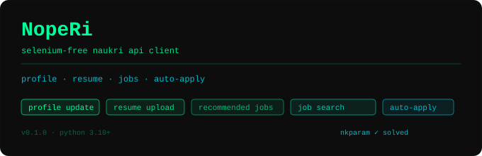

<p align="center">
  
</p>

# NopeRi

One of the few fully working Naukri.com API clients — Selenium-free, with an AI-powered automated job application agent.  
Login, search, score, and apply — all without touching a browser.

**Status:** 🟢 Working — last tested November 2026  
**Latest fix:** Decoded Naukri's BotGuard `vid` header; login now works reliably without any browser session.

## ✨ Features

| Feature | Status |
|---|---|
| Login and session management (Bearer token) | ✅ Working |
| Cookie-based session resume | ✅ Working |
| Auto-skip login if `.env` has credentials | ✅ Working |
| Resume upload (PDF) | ✅ Working |
| Profile update (headline, name, summary) | ✅ Working |
| Job search (`/jobapi/v3/search`) | ✅ Working |
| Recommended jobs feed | ✅ Working |
| One-click easy apply | ✅ Working |
| AI job scoring 0–100 (optional) | ✅ Working |
| AI questionnaire answerer with cache | ✅ Working |
| Custom Q&A patterns via wizard + config | ✅ Working |
| Browser-based 5-step setup wizard | ✅ Working |
| Application tracking (SQLite + CSV) | ✅ Working |
| HTML dashboard with charts | ✅ Working |
| Veto list (companies + job titles) | ✅ Working |
| Scheduled runs via crontab (Ubuntu/Linux) | ✅ Working |
| Telegram alerts on apply / failure / summary | ✅ Working |
| OTP / MFA login | ✅ Working |
| Change-detection smoke tests | ✅ Working |

## ⚙️ Installation

**Requirements:** Python 3.10+, Node.js 14+ (for `vid` token generation)

```bash
git clone https://github.com/Traverser25/NopeRi.git
cd NopeRi
pip install -r requirements.txt
```

Create a `.env` file in the project root:

```env
NAUKRI_USERNAME=your_naukri_email@example.com
PASSWORD=your_naukri_password

# AI scoring + questionnaire answerer — optional
OPENROUTER_API_KEY=sk-or-...
# or for OpenAI direct:
OPEN_API_KEY=sk-...

# Telegram alerts — optional
TELEGRAM_BOT_TOKEN=123456:ABC-DEF...
TELEGRAM_CHAT_ID=your_numeric_chat_id
```

> **Security note:** API keys and Telegram credentials entered in the setup wizard are written to `.env` only — never to `config.json`.

## 🚀 First Run

```bash
python apply_agent.py

# Windows — if `python` resolves to the wrong interpreter:
run.bat
```

On first run (no `config.json`), a browser wizard opens at `http://localhost:8765` to walk you through setup.

## 🧙 Setup Wizard

5 steps, takes about 2 minutes. Re-run any time with `--setup`.

| Step | What it does |
|---|---|
| **1. Account** | Login with email/password or paste cookies. Auto-skipped when `NAUKRI_USERNAME` + `PASSWORD` are in `.env`. |
| **2. Profile** | Role focus, years of experience, tech stack, locations, CTC, notice period. |
| **3. AI** | Provider (OpenRouter / OpenAI), model, API key (saved to `.env`), score threshold, custom Q&A patterns. Shows a badge if a key is already set in `.env`. |
| **4. Automate** | Generates a crontab entry for Ubuntu/Linux — pick time, days, timezone. Install in one click or copy-paste manually. Telegram bot token + chat ID (saved to `.env`). |
| **5. Done** | Summary → Save & Close writes `config.json`. |

## 🖥️ Commands

```bash
# Run the agent — search, score, and apply
python apply_agent.py

# Re-run the setup wizard
python apply_agent.py --setup

# Open the HTML dashboard (stats, charts, recent applications)
python apply_agent.py --dashboard

# Print the last 50 applied jobs
python apply_agent.py --list-applied

# Allow re-applying to a specific job (removes it from history)
python apply_agent.py --remove-job <HASH>

# Veto list management
python apply_agent.py --veto list
python apply_agent.py --veto add-company "Infosys"
python apply_agent.py --veto remove-company "Infosys"
python apply_agent.py --veto add-title "walk-in"
python apply_agent.py --veto remove-title "walk-in"
```

## 🗂️ Project Structure

```
NopeRi/
├── apply_agent.py          # Main entry point
├── run.bat                 # Windows launcher (uses py instead of python)
├── user_prompt.md          # AI scoring prompt — edit to tune behaviour
├── requirements.txt
├── .env                    # Credentials and API keys (gitignored)
├── config.json             # Generated by setup wizard (gitignored)
├── veto.json               # Veto list (gitignored)
├── applied_jobs.db         # SQLite application tracker (gitignored)
├── applied_jobs.csv        # CSV export (gitignored)
├── qa_cache.json           # Questionnaire answer cache (gitignored)
├── tests/
│   └── test_api.py         # Change-detection smoke tests
├── cron/
│   ├── scheduler.py        # APScheduler runner (profile updates)
│   ├── profile_updater.py  # Scheduled profile headline / resume refresh
│   └── telegram_alert.py   # Telegram notification helpers
└── src/
    ├── client/
    │   ├── naukri_client.py     # Auth, profile, resume upload
    │   ├── job_client.py        # Search, recommended jobs, apply
    │   ├── job_classifier.py    # AI scoring + filter pipeline
    │   ├── questionnaire_ai.py  # AI questionnaire answerer + cache
    │   └── session.py           # curl_cffi session factory
    ├── config/
    │   └── constants.py         # API URLs, header constants
    ├── exceptions/
    │   └── exceptions.py        # Custom exception hierarchy
    ├── models/
    │   └── models.py            # Job dataclass and other models
    └── utils/
        ├── config_manager.py    # config.json / veto.json read-write
        ├── dbhandler.py         # SQLite + CSV application tracker
        ├── web_setup.py         # Browser-based setup wizard server
        ├── extractors.py        # HTML / JS parsing helpers
        ├── formkey.py           # Form key extraction
        ├── nkparam_generator.py # nkparam token generation
        ├── request_helper.py    # Exponential retry decorator
        ├── vid_generator.py     # BotGuard vid token (Node.js bridge)
        └── botguardSdk_v1.min.js
```

## 🔧 Configuration

All settings live in `config.json`, generated by the wizard. Edit directly or re-run `--setup`.

| Section | Key fields |
|---|---|
| `profile` | `role_focus`, `experience_years`, `tech_stack`, `locations`, `apply_remote`, `current_ctc`, `expected_ctc`, `notice_days` |
| `ai` | `provider`, `model`, `score_threshold`, `daily_apply_limit` |
| `questionnaire` | `skip_ai`, `common_qa` |
| `queries` | List of `{keyword, location}` search queries |
| `session` | Stored `nauk_at` / `nauk_rt` cookies |
| `cron` | `apply.schedule` (HH:MM), `apply.days`, `apply.timezone` |
| `telegram` | `enabled`, `alerts.*` toggle flags |

Edit `user_prompt.md` to tune how the AI scores and filters jobs.

## 🤖 AI Scoring

When an API key is set, each job is scored 0–100 by the LLM before applying. Jobs below `score_threshold` (default 50) are skipped. Without a key, all fetched jobs go to the apply loop.

| Provider | Env var |
|---|---|
| OpenRouter — recommended, access to all models | `OPENROUTER_API_KEY` |
| OpenAI direct | `OPEN_API_KEY` |

## 🧠 AI Questionnaire Answerer

When a job has a screening questionnaire, `questionnaire_ai.py` answers it automatically before submitting. Resolution order:

1. **Cache** (`qa_cache.json`) — previous answers reused instantly, zero API tokens.
2. **Common Q&A** — 20+ profile-derived patterns (notice period, CTC, experience, relocation, stack-specific) matched without any API call.
3. **Batched AI call** — all unknown questions sent in one request (not one per question).
4. **Static fallback** — heuristics when no AI key is configured.

**Add your own patterns** in the wizard (Step 3 → Questionnaire AI) or directly in `config.json`:

```json
"questionnaire": {
  "skip_ai": false,
  "common_qa": [
    {"question": "rotational shifts",         "answer": "No"},
    {"question": "bond or service agreement", "answer": "No"},
    {"question": "valid passport",            "answer": "Yes"}
  ]
}
```

Questions match case-insensitively as substrings — `"rotational shifts"` matches *"Are you comfortable with rotational shifts?"*.  
Set `skip_ai: true` to disable AI calls while still using the cache and common patterns.

## 📂 Application Tracking

Every successful application is recorded in:

- `applied_jobs.db` — SQLite, used for fast dedup on every run
- `applied_jobs.csv` — human-readable backup

Both persist across runs and are gitignored. Use `--list-applied` to view history and `--remove-job <HASH>` to allow re-applying to a specific job.

## 📊 Dashboard

```bash
python apply_agent.py --dashboard
```

Opens an HTML page in your browser showing:
- Stat cards — total applied, score tiers (≥70 / 50–69 / <50 / no score)
- Bar chart — applications per day (last 30 days)
- Horizontal bar — top 8 companies applied to
- Recent applications table with colour-coded score pills

## ⏰ Scheduled Runs (Ubuntu / Linux)

The setup wizard (Step 4 → Automate) generates the exact crontab line and can install it in one click. Or do it manually:

```bash
# example: run at 08:00 Mon–Fri, append to log
0 8 * * 1-5 cd /path/to/NopeRi && python3 apply_agent.py >> /path/to/NopeRi/noperi.log 2>&1
```

```bash
crontab -e   # paste the line, save
crontab -l   # verify
```

> **Windows:** crontab is not supported. Run `python apply_agent.py` manually or configure Task Scheduler yourself.

For profile headline / resume refresh on a separate schedule, `cron/scheduler.py` (APScheduler) is still available:

```bash
python cron/scheduler.py
```

## 🔔 Telegram Alerts

Set `telegram.enabled = true` in `config.json` and add credentials to `.env`:

```env
TELEGRAM_BOT_TOKEN=123456:ABC-DEF...
TELEGRAM_CHAT_ID=your_numeric_chat_id
```

Alert types (each toggleable under `telegram.alerts`):

| Alert | Default |
|---|---|
| `on_apply` — fired after each successful application | on |
| `on_failure` — fired when an apply throws an error | on |
| `on_run_summary` — fired at end of each run with stats | on |
| `on_questionnaire` — fired when a questionnaire is detected | off |
| `on_scheduler_start` — fired when cron scheduler starts | on |

## 🧪 Tests

Change-detection smoke tests that fail fast when Naukri changes their API shape.

```bash
# Full suite — hits live Naukri (requires credentials in .env)
pytest tests/ -v

# Offline only — no network required
pytest tests/ -v -m "not live"
```

| Test | What it catches |
|---|---|
| `test_vid_token_generates` | Node.js bridge broken, BotGuard SDK changed |
| `test_login_returns_nauk_at` | BotGuard auth flow changed, password login blocked |
| `test_job_search_returns_results` | Search endpoint URL / params changed |
| `test_job_schema_has_required_fields` | Naukri renamed `job_id` / `title` / `company` / `location` |
| `test_recommended_jobs_schema` | Same check for the recommended feed |

## 🔑 The `nkparam` Token

Naukri's search endpoint requires a signed `nkparam` header computed from their client-side JS. `nkparam_generator.py` handles this internally — no browser needed. On a 403 the pool rotates to the next available token automatically.

## 🤝 Contributing

Naukri updates their API and auth headers without notice. If something breaks for you, please open an issue — it helps everyone.

**Most useful contributions:**

- **API breakage reports** — if login, search, or apply stops working, open an issue with the error and the endpoint that failed. Include the HTTP status code if you can.
- **New questionnaire patterns** — spotted a common screening question that the AI gets wrong? Share the question and the right answer in an issue. It goes straight into `common_qa`.
- **New veto patterns** — job titles or company names worth filtering by default.
- **Fixes for the `vid` / `nkparam` token** — these are the most likely things to break. If you figure out an update, a PR is very welcome.
- **Testing on other distros / Python versions** — currently tested on Ubuntu and Windows with Python 3.10–3.13.

Before opening a PR, run the tests first:
```bash
pytest tests/ -v
```

## ⚠️ IP and Hosting Notes

Naukri fingerprints IPs. Sessions are IP-bound — changing IP mid-session invalidates the login.

| Environment | Result |
|---|---|
| Home broadband / personal IP | Best — zero flags |
| AWS EC2 with Elastic IP | Works |
| Mobile hotspot | Works for testing |
| Azure / GitHub Actions | Blocked — Microsoft ASN is fully burned |
| Datacenter IP ranges | Usually blocked |

## 📋 Disclaimer

This project automates your own Naukri account for personal use. Use it responsibly and in accordance with [Naukri's Terms of Service](https://www.naukri.com/termsAndConditions). Not affiliated with Naukri / InfoEdge India Ltd.
